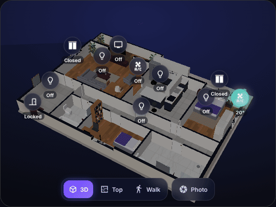
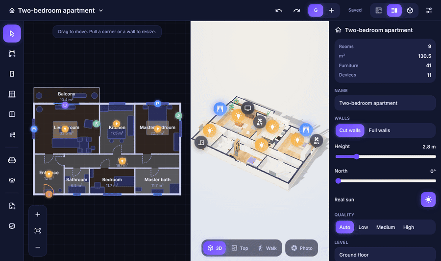

# Roost Atelier

**Build your home in realistic 3D by drag and drop, then watch it live on your Home Assistant dashboards: lights, curtains, ACs, doors and people.**

[](https://hacs.xyz)
[](https://github.com/HRadhi4/Roost-Atelier/actions/workflows/validate.yml)

<a href="https://ko-fi.com/hradhi4"></a>

<p align="center"></p>

Roost Atelier is a home designer that lives inside Home Assistant. You draw the rooms with your finger, drop in furniture and devices, and you get a lifelike 3D model of your home. Put that model on any dashboard and it comes alive: lamps glow and light the floor, curtains slide, doors swing open, the AC blows air, the TV plays, and the sun moves across the rooms at the real time of day.

You don't need to know any design software or write code.

It is part of the **Roost** family, alongside [Roost Cards](https://github.com/HRadhi4/Roost-card).

---

## What you can do

### Design
- **Draw rooms** by dragging a rectangle. Pull a corner or a wall to resize it, and the rooms next to it follow, so walls stay joined.
- **Add doors, windows, sliding doors and arches** by tapping a wall. Slide them along the wall, change the width with a slider, and flip which way the door opens.
- **Furnish** from a library of about 120 pieces, with a search box: sofas, beds, dining sets, majlis seating, kitchens, bathrooms, home office, fitness, plants and lamps. Drag a piece near a wall and it turns to face the room and sits flat against the wall, the way a designer would place it.
- **Pick finishes** with one tap: wood, herringbone, porcelain, marble, terrazzo and carpet floors, nine wall paints, and fabric colours.
- **Feature walls:** give one wall of a room its own paint, wallpaper (stripes, trellis, classic, grasscloth), stone, marble slabs, wood slats or classic moulded panels.
- **Ceilings:** set a lower ceiling height for any room, add a gypsum border (with or without a hidden light) and a cornice. Add **skirting** in white, black, wood or the floor's own finish, and pick the colour of door and window **frames** and of each door.
- **Your own materials:** add a photo of a tile, wood, stone or fabric from your supplier (Settings → *Your materials*), say how many metres one photo covers, and use it on floors, feature walls and furniture.
- **Each piece its own finish:** fabric, wood (light oak, ash, walnut, dark wood, white) and metal (black, brass, chrome, bronze).
- **Structure and joinery:** columns, round columns and beams; a built-in wardrobe and a TV wall. **Fit to the wall** makes a wardrobe, kitchen run, TV wall or shelf exactly as wide as the wall it stands against.
- **Measure and annotate:** the tape measure gives the distance between any two points (it snaps to walls and corners) and can keep it on the plan as a dimension line; **notes** can be written anywhere. Both print with the plan.
- **Lock in place** anything you don't want to move by accident.
- **Check the home**: the Atelier points out rooms with no door, bedrooms with no window, furniture blocking a door, and devices that aren't linked yet. Many of these it can fix in one tap.
- **Several levels**: tap **+** next to **G** at the top to add a level. It starts with the outline of the level below. On a dashboard, each card shows one level.
- **Stairs** (in the *Building* furniture tab) take the height of the level, and **Show the levels below in 3D** (Settings) draws the lower levels under the one you are on, so the home reads as one building.
- **Several pieces at once:** Shift or Ctrl + tap (or *Select several* on a phone) to pick pieces, then move them together, line them up, spread them evenly, copy or delete them.
- **Wall lengths** are written along every wall (the ruler button hides them), and the **printer button** prints a clean plan on white paper with room names, areas and a scale bar.
- **Undo and redo** everything. Your work saves automatically.

### Your work is safe
- **Saves never get lost:** if Home Assistant restarts or the Wi-Fi drops, the Atelier keeps trying and keeps your changes on the device meanwhile. Closing the page with unsaved changes asks first.
- **Earlier versions:** the last 10 versions of each home are kept (Homes menu → Earlier versions), and **deleted homes** can be brought back.
- **Save to a file / Load from a file** to back a home up or move it to another Home Assistant.
- **Two screens:** if the same home is changed on another screen, you choose which version to keep. Nothing is overwritten silently.

### Import
- **From CAD, PDF or a picture of a plan** (DXF, PDF, JPG, PNG): walls become rooms, and gaps in the walls become doors and windows. Named furniture blocks in a DXF become furniture.
- **From a photo of a room**: a small AI running on your own device (free and private; it downloads its model once, about 150 MB), or Home Assistant's own AI (any AI Task, such as Google Gemini or OpenAI) for finer detail, finds the furniture, ceiling lights (spots, twin spots, LED panels, slot lights, pendants, chandeliers), curtains, windows, the air conditioner and the TV, with their colours, sizes and counts. Say which wall you were facing, check the list, and everything is placed in the room, with lights, curtains, the AC and the TV linked to the devices in the matching Home Assistant area.

### Light that behaves like the real thing
Roost Atelier lights your home **once**, then never has to render it again.

- **Baked once, mixed live.** When the home is ready, the computer that opened the Atelier works out how every lamp, every window and the sun at several times of day light each surface, including light bouncing off walls, floors and furniture. Each one is kept as its own layer on your Home Assistant server. Switching, dimming or recolouring a lamp, opening a curtain or the sun moving just mixes those layers: instant, smooth, even on a tablet.
- **Only when something moves.** Lamps, curtains, weather and the time of day never need a new bake. Moving a wall, a lamp or furniture does: it is redone by itself in the background on the next computer that opens the Atelier, and every screen picks it up.
- **Real brightness.** Each lamp has its real output in lumens and its warmth in kelvin (or follows the bulb's own colour from Home Assistant). The sun and sky follow `sun.sun` and your weather entity (clear, cloudy, rain).
- **Calm and steady, easy on the eyes.** Like a photographer, the Atelier sets the exposure once from the daylight, never from the lamps, so switching lights never makes the picture jump. Day is bright and true, evening warm, night calm and lamp-lit. Lamps add a soft pool of light and their warmth: more lamps feel cosier, not glaring (one *Lamp glow* slider sets how strong). Sun patches glow without blinding.
- **Every kind of ceiling light:** recessed spots in the gypsum, track lights (length, number of heads, tilt and where they point), linear lights and hidden coves that wash the ceiling, and **focus lights** you aim at a painting by dragging a target on the plan; they stay real accents with a clear pool.
- **Lamps that aren't smart** take part too: always on, always off, on after sunset, or between set times.
- **Match your real room.** Each room has a brightness slider, and *Match a photo of this room* reads the colour of the light in a photo and sets the lamps' warmth to it.

### Control everything from the 3D home
- **Tap any device** to get a small pop-up with its controls right next to it (lights, ACs, curtains, TVs, fans, locks). Walking through a room, a side panel lists everything in that room. Prefer one-tap switching? Set *Tapping a device* to *Turns it on or off*.

### A light dashboard card made of pictures
- Design the home in the Atelier, then press **Make dashboard pictures** (home settings). It renders a finished photo of the whole floor and a realistic 360° picture of every room, with the real light.
- The **Roost Home Tour** card in [Roost Cards](https://github.com/HRadhi4/Roost-card) shows those pictures, like a street-view tour of your home: tap a room to step in, drag to look around, follow the arrows on the doors to the next room, and tap any light, AC, curtain or TV right where it is. Lights that are on glow in their own colour.
- No 3D engine is loaded on the dashboard, so the card opens fast on phones and wall tablets.

### Realistic photos with local AI
- **Photo mode** traces light bounce by bounce, then a **local AI denoiser** (Intel Open Image Denoise, the same kind of AI that professional renderers use) cleans the picture. It runs on your own computer's graphics through WebGPU; nothing leaves your home.
- **Photos of the whole floor and every room, by themselves.** Once the light is ready, the Atelier makes a finished photo of the whole floor and of each room in the background, on its own hidden canvas, so you keep working. A bar shows how far it is. The photos are kept in Home Assistant (Settings → Room photos) and made again when you change the home.
- **On your dashboard:** the Roost 3D Home card from [Roost Cards](https://github.com/HRadhi4/Roost-card) shows the live 3D home with these photos.

### Easy to use
- **Ceiling mode:** one button on the plan fades the furniture so only the lights remain. Lights line up with each other and with the middle of the room as you drag (guide lines show it), **Fill the room evenly** makes a grid (for example 3 × 4) in one tap, and you can type a light's exact distance from the walls.
- **Real reflections:** glossy floors (tiles, marble, polished concrete, lacquered wood) reflect their own room; worked out once when the light changes, never every frame.
- **Walk with the keys:** in Walk, the arrow keys (or W A S D) walk and turn; walls stop you. Tapping a spot on the plan walks you there.
- **Type any size:** every slider also takes a typed number.
- **See the piece you pick:** a small 3D model of the chosen furniture turns in the side panel and follows every change.

### Live on your dashboards
- **Lights** glow in their real colour and brightness.
- **Curtains and blinds** open to their real position, and the daylight in the room follows.
- **Doors** swing open when a door sensor opens.
- **ACs** show moving air when they're on. **Ceiling fans** turn. **TVs** light up.
- **People** appear when they're home, and a **presence radar** (Athom, LD2450 and similar) shows each person it sees walking in the right spot, on the plan and in 3D. Place it on the wall, pick its *target 1 x* sensor, and turn it to face the room.
- **Tap** a device to switch it. **Press and hold** to open its details.
- **Three views**: a 3D overview, a top-down plan, and walk-through, where you stand inside a room at eye height.

### Smooth on tablets
Tablets and phones never do the heavy work: they only show the light a computer has baked. The home is only redrawn when something changes. While you drag, it draws at lower sharpness and sharpens again when you let go. Quality adjusts to your device automatically, or you can choose it yourself. The dashboard card loads a 6 KB file; the 3D engine loads only when a card is on screen.

### Five languages
English, Arabic, Spanish, Russian and Simplified Chinese. Pick one in Settings (or let it follow your Home Assistant language). In Arabic the whole layout switches to right-to-left.

---

## Install

### With HACS (recommended)
1. Open **HACS** and search for **Roost Atelier**.
2. Install it, and restart Home Assistant.
3. Go to **Settings → Devices & services → Add integration**, and add **Roost Atelier**.

If HACS does not find it yet, add it by hand first: open the menu in the top corner of HACS, choose **Custom repositories**, add `https://github.com/HRadhi4/Roost-Atelier` with type **Integration**, then carry on from step 1.

### By hand
Copy `custom_components/roost_atelier` into your `config/custom_components` folder, restart, and add the integration as in step 3.

**Atelier** now appears in the sidebar (administrators only). You don't need to add any dashboard resource: the card is available on every dashboard right away.

---

## Tutorial: your first home in five minutes

<p align="center"></p>

**1. Start.** Open **Atelier** in the sidebar. The first time, a short guide walks you through the six steps below, pointing at each button (open it again with the **?** button at the top). Tap the home name at the top and choose where to start: a ready-made home (apartment, villa with majlis, or studio), a blank page, or **From CAD or PDF**.

**2. Shape the rooms.** Tap a room once to select it. Then:
- drag the white squares in the middle of each wall to move that wall;
- drag the purple circles to move a corner;
- drag inside the selected room to move the whole room, with everything in it.
Walls snap to their neighbours, and the length of every wall is shown as you go. With the **Rooms** tool you can drag out a new room anywhere.

**3. Name and finish.** With a room selected, pick its type (bedroom, majlis, kitchen…), its floor and its wall paint on the right.

**4. Doors and windows.** Pick **Door**, **Window**, **Slider** or **Arch** on the left, then tap a wall. Drag it along the wall, and use the sliders to change its size. **Flip** changes the way a door opens; **Main** marks the front door.

**5. Furniture.** Open **Furniture**, type what you want in the search box (*bed*, *lamp*, *treadmill*) or choose a category, and drag a piece onto the plan (or tap it to drop it in the selected room). The pieces you used lately wait at the top. Near a wall, a piece turns and sits against the wall by itself. Drag the round handle to turn it; use the sliders for its size and the swatches for its colour. The arrow keys move what is selected by 5 cm (1 cm with Shift).

**6. Devices.** Open **Devices** and drag in lights, ACs, curtains, TVs, doors and people. Tap one and choose its entity from the list. Until it's linked it shows a demo state, so you can see how it will look.

**6b. Make the light true to life.** Tap a lamp:
- **Light output**: the lumens printed on the bulb's box (a typical ceiling light is 1,500–2,000 lm, a table lamp 400–800 lm).
- **Warmth**: 2700 K is warm like a classic bulb, 4000 K is neutral, 6500 K is cool daylight. Smart bulbs that report their colour follow it by themselves.
- **Not smart?** Leave it unlinked and choose when it is on: always, after sunset, or between two times.
Then tap a room: **Room brightness** fine-tunes it, and **Match a photo of this room** reads the colour of the light in a photo of the real room.

The first time, the computer you are using bakes the light (a progress bar shows *Lighting*). It takes about a minute for a flat on a typical computer, and only happens again when you move walls, lamps or furniture.

**7. Check.** Tap **Check the home** (the badge at the bottom of the left rail). Fix anything it finds, many with one tap.

**8. Put it on a dashboard.** Open the home settings, make the **Dashboard pictures**, then add **Roost Home Tour** from [Roost Cards](https://github.com/HRadhi4/Roost-card) to a dashboard.

### Importing a drawing
Open **Import**, choose a DXF, PDF, JPG or PNG, and wait a moment. Check the number of rooms found:
- If the rooms look too big or too small, move **Drawing width** until a door is about 0.9 m wide.
- If two rooms joined through a wide double door, choose **Wide double doors**.
Tap **Use this plan**, then name the rooms and run **Check the home**.

### Furniture from a photo
Select a room, open **Import**, choose **From a photo**, and pick or take a photo of the room. Untick anything you don't want, then tap **Add**.
- **This device (free, private)** reads the photo on the screen you are using; the photo never leaves it. The reading model (about 150 MB) is fetched once by Home Assistant and kept there for every screen in the home.
- If you have an AI Task set up in Home Assistant, you can pick it instead.

## On your dashboard

Add **Roost Home Tour** from [Roost Cards](https://github.com/HRadhi4/Roost-card). It shows the pictures the Atelier makes. Dashboards that already use the Atelier's own live 3D card keep working.

---

## Support

If Roost Atelier makes your home nicer, you can buy me a coffee on Ko-fi. It helps me keep adding features and fixing problems.

<a href="https://ko-fi.com/hradhi4"></a>

## Licence

Free and open source under the [MIT License](LICENSE).

The bundled open-source libraries keep their own licences. See `custom_components/roost_atelier/frontend/THIRD-PARTY-LICENSES.txt`.

## For developers

```bash
npm ci --legacy-peer-deps
npm test          # plan and import checks
npm run build     # builds the frontend into custom_components/roost_atelier/frontend
```
